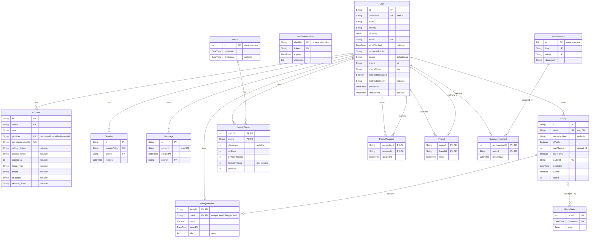

_This project has been created as part of the 42 curriculum by mnijsen, svan-hoo, lade-kon, and mde-beer_

# People In Tires
## __Description:__

PIT(People In Tires) is a game in which you play as the pitstop crew in a F1 race.

## __Instructions:__

To start the server it needs a .env with some server details.

```
POSTGRES_HOST_AUTH_METHOD=trust
AUTH_TRUST_HOST=true

POSTGRES_USER="postgres"
POSTGRES_DB="prisma"

MAIL_USER= {mail address password recovery will happen from}
MAIL_APP_PASSWORD= {password for mail account}
AUTH_42_SCHOOL_ID= {key from oauth service}
AUTH_42_SCHOOL_SECRET= {key from oauth service}
AUTH_GITHUB_ID= {key from oauth service}
AUTH_GITHUB_SECRET= {key from oauth service}
```

For the OAuth to work the service needs to be registered at either/both Github and 42, provide the keys for the registered server in .env.

To self-sign some SSL certificates so nginx will work, provide your own in the files
`nginx/ssl/nginx.crt` and `nginx/ssl/nginx.key` respectively, or run:
```sh
openssl req -x509 -nodes -days 365 -newkey rsa:2048 \
	-keyout nginx/ssl/nginx.key \
	-out nginx/ssl/nginx.crt \
	-subj "/C=Country/ST=State/L=City/O=Org/CN=localhost"
```

For forgot password needs a registered email API which provides the keys for the registered emailaddress to send the code from in our case it is gmail. For the OAuth to work the service needs to be registered at either/both Github and 42, provide the keys for the registered server in .env. 
`docker compose up --build`

## __Resources:__

- [react](https://react.dev/reference/react)
	- [react-draggable](https://www.npmjs.com/package/react-draggable)
	- [react-zustand](https://www.npmjs.com/package/zustand)
- [next](http://nextjs.org/docs)
- [prisma](https://www.prisma.io/docs/orm)
- [rust](https://docs.rs/docsrs/latest/docsrs/)

ai usage: Suspiciously high fidelity leaf used as a temp image. Various styles, colors, and images are generated with Ai. Ai has been used by multiple teammembers for explaining programming concepts.

## __Team Information:__

- Milan Nijsen (mnijsen): PO, Developer, Artist  
- Simon van Hoogstraaten (svan-hoo): Developer  
- Laura de Koning (lade-kon): PM, Developer  
- Mats de Beer (mde-beer): Tech Lead, Developer  

## __Project Management:__

Communication and coordination in this project happened primarily over our discord channel, github issues, and sprints. We had weekly standup meetings to discuss what work has been done and what work is planned by each member for the upcoming week.

## __Technical Stack:__

- Front and backend: Next.js (built on react)
  -> Cause it was first on the list in the subject en now prior knowledge was present in the team
- Database: Postgres
  -> Never used databases before, did some Google searches and came to the conclusion that this in combination with Prisma 
- ORM: Prisma
  -> Possibility to look at your database with prisma studio
- Simulation: Wasm, Rust
    + we knew we were gonna be doing some heavy computation in our simulation,
      but that we still needed easy access to the types. WebAssembly is therefore
      an obvious compilation target, as js/ts has native support for it.
    + rust has fairly robust tooling for compilation targetting Wasm, also Mats
      finds it fun to write
- Reverse proxy: nginx
    + nextjs does not have a native https server built-in, nginx is a mature and
      well-documented tool for (among other things) acting as a reverse-proxy

## __Database Schema:__
The schema can be found in /pit/prisma/schema.prisma. Reading the prisma.schema explains the schema, but here is a visualisation.


## __Features List:__
**Game:** it has a game about pitstoping (_Milan, Simon_)  
**Sim:** it features a racing simulation (_Mats_)  
**Website:** its on a website (_Laura, Simon_)  


## __Modules:__

### IV.1 Web  
#### Major — Full-stack framework  
Use a framework for both the frontend and backend.  
  - Use a frontend framework (React, Vue, Angular, Svelte, etc.).  
  - Use a backend framework (Express, NestJS, Django, Flask, Ruby on Rails,
  etc.).  
  - Full-stack frameworks (Next.js, Nuxt.js, SvelteKit) count as both if you use both their frontend and backend capabilities.  
> **Implementation (2 points)**  
> PIT is built using Next.js, which provides tools for the front- and backend.  

#### Major — User interaction
Allow users to interact with other users. The minimum requirements are:  
  - A basic chat system (send/receive messages between users).  
  - A profile system (view user information).  
  - A friends system (add/remove friends, see friends list).  
> **Implementation (2 points)**  
> User to user interaction: PIT has a global chat, a profile page for the user, and supports adding/removing friends.  

#### Minor — ORM
Use an ORM for the database.  
> **Implementation (1 point)**  
> ORM implementation: PIT's database is implemented using Prisma ORM.  
  
#### Minor — Server-Side Rendering (SSR)
Server-Side Rendering (SSR) for improved performance and SEO.  
> **Implementation (1 point)**  
> Server-Side rendering: Next.js's server components have been utilized throughout PIT.  

#### Minor — Reusable components
Custom-made design system with reusable components, including a proper
color palette, typography, and icons (minimum: 10 reusable components).  
> **Implementation (1 point)**  
> Reusable Components: Throughout the games code various reusable components and logic is used, additionally there is a site wide style that can be selected in profile.  

#### Minor — Browser Compatibility
Support for additional browsers.  
  - Full compatibility with at least 2 additional browsers (Firefox, Safari, Edge,
  etc.).  
  - Test and fix all features in each browser.  
  - Document any browser-specific limitations.  
  - Consistent UI/UX across all supported browsers.  
> **Implementation (1 point)**  
> Additional browser support: PIT functions on all browsers which support modern css, standard behaviour on Chrome, Edge, and Brave.  

### IV.3 User Management  
#### Major — User management and Authentication
Standard user management and authentication.  
  - Users can update their profile information.  
  - Users can upload an avatar (with a default avatar if none provided).  
  - Users can add other users as friends and see their online status.  
  - Users have a profile page displaying their information.  
> **Implementation (2 points)**  
> Standard user management and authentication:  
	- Users can modify profile information like: username, avatar, personal details etc.  
	- Pit features a friend list with their current status.  

#### Minor — OAuth
Implement remote authentication with OAuth 2.0 (Google, GitHub, 42,
etc.).  
> **Implementation (1 point)**  
> OAuth 2.0: PIT allows for linking a account with a GitHub and 42 account.  

### IV.6 Gaming and user experience  
#### Major — Web-based game
Implement a complete web-based game where users can play against each
other.  
  - The game can be real-time multiplayer (e.g., Pong, Chess, Tic-Tac-Toe, Card
  games, etc.).  
  - Players must be able to play live matches.  
  - The game must have clear rules and win/loss conditions.  
  - The game can be 2D or 3D.  
> **Implementation (2 points)**  
> Web based game: PIT features minigames implemented in React and a simulation created in Rust.  

#### Major — Remote players
Remote players — Enable two players on separate computers to play the
same game in real-time.  
  - Handle network latency and disconnections gracefully.  
  - Provide a smooth user experience for remote gameplay.  
  - Implement reconnection logic.  
> **Implementation (2 points)**  
> Remote players: Multiple clients can subscribe to a lobby, information in syncronised via the database as this contains the most recent 'race state'.  

#### Major — Multiplayer game
Multiplayer game (more than two players).  
  - Support for three or more players simultaneously.  
  - Fair gameplay mechanics for all participants.  
  - Proper synchronization across all clients.  
> **Implementation (2 points)**  
> Multiplayer game: The lobby is limited to 12 players max. Balance is fairer the more players as the cpus are busted.  

#### Minor — Spectator mode
Implement spectator mode for games.  
  - Allow users to watch ongoing games.  
  - Real-time updates for spectators.  
  - Optional: spectator chat.  
> **Implementation (1 point)**  
> Spectator: If there are more players then racers the remaining will still be in the game and spectating, sees chat and minimap  

### IV.10 Modules of choice  
#### Minor — Custom Modules
Same as the major module but smaller in scope and less complex.  
  - Must still demonstrate technical skill and creativity.  
  - Should add meaningful value to your project.  
  - Requires justification in README.md (similar to Major, but for 1 point).  
> **Implementation (1 point)**  
> Web assembly: Multiple languages were utilized for People in Tires, most notably utilizing the Rust compiled to Web Assembly code inside of the JavaScript. 
> **Implementation (1 point)**  
> Persistent Central State: The race simulation is implemented via saving the state in the database and then calculating the next simulated step. Clients pull the most recent racestate(with the correct id) to know the state of the game.  

## __Individual Contributions:__

### Milan Nijsen (mnijsen)
**Contribution:** Game development + game engine  
**Modules:**  
- Major — Full-stack framework  
- Minor — Server-Side Rendering (SSR)  
- Minor — Reusable components  
- Minor — Browser Compatibility  

- Major — Web-based game  
- Major — Remote players  
- Major — Multiplayer game  

**Challenges:** 
### Simon van Hoogstraaten (svan-hoo)
**Contribution:** State system game, Lobby, Inventory  
**Modules:**  
- Major — Full-stack framework  
- Minor — Server-Side Rendering (SSR)  
- Minor — Reusable components  
- Minor — Browser Compatibility  

- Major — Web-based game  
- Major — Remote players  
- Major — Multiplayer game  

**Challenges:** 
### Laura de Koning (lade-kon)
**Contribution:** Database, usermanagement and styling of the webpages.  
**Modules:**  
- Major — Full-stack framework  
- Minor — Server-Side Rendering (SSR)  
- Minor — Reusable components  
- Minor — Browser Compatibility  

- Major — User interaction  
- Minor — ORM  
- Major — User management and Authentication  
- Minor — OAuth   

**Challenges:** setting up the database and working with docker without completing Inception. Overcome with trial and error.  
### Mats de Beer (mde-beer)
**Contribution:** Simulation, Docker, Database setup  
**Modules:**  
- Major — Full-stack framework  
- Minor — Server-Side Rendering (SSR)  
- Minor — Reusable components  
- Minor — Browser Compatibility  

- Minor — Spectator mode  
- Major — Multiplayer game  
- Minor — Custom Modules  

**Challenges:** 
